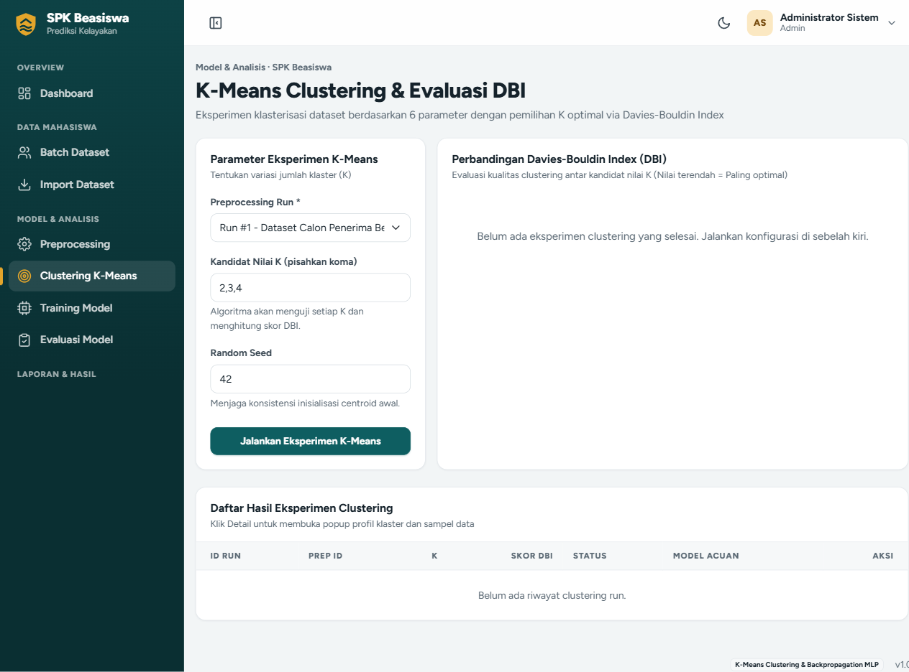
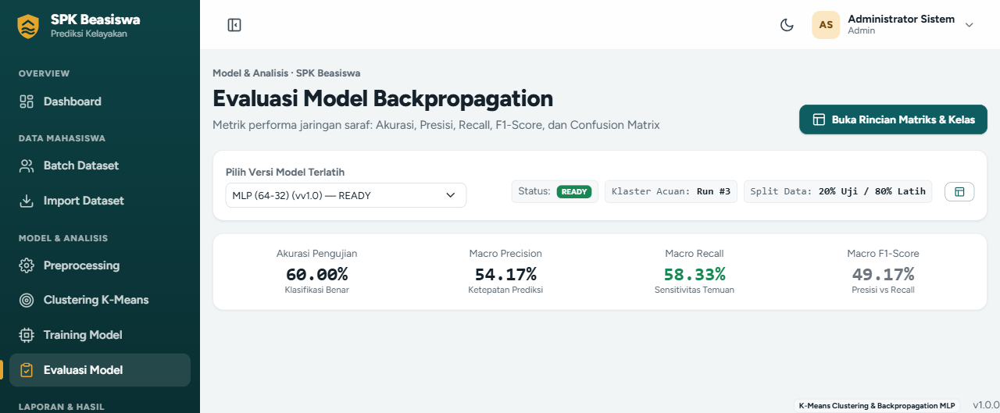

# SPK Seleksi Beasiswa (K-Means & Backpropagation)

Sistem Pendukung Keputusan (SPK) berbasis web untuk menentukan rekomendasi kelayakan penerima beasiswa berdasarkan **6 Indikator Kriteria** menggunakan kombinasi algoritma **K-Means Clustering** dan **Artificial Neural Network Backpropagation (MLP)**.

---

## Cara Menjalankan Aplikasi

### 1. Database (MySQL / XAMPP)
1. Buka **XAMPP Control Panel**, lalu klik **Start** pada modul **MySQL** (Port `3306`).
2. Buat database baru bernama `beasiswa_spk` melalui phpMyAdmin (`http://localhost/phpmyadmin`).
3. *(Skema tabel, akun user, dan 50 data awal mahasiswa otomatis di-seed oleh backend saat pertama kali dijalankan).*

---

### 2. Jalankan Backend (FastAPI)
Buka terminal (PowerShell / Command Prompt) di folder proyek:

```powershell
cd backend
python -m venv venv
venv\Scripts\activate
pip install -r requirements.txt
uvicorn app.main:app --reload --port 8000
```
- **Backend API**: `http://127.0.0.1:8000`
- **Swagger Docs**: `http://127.0.0.1:8000/docs`

---

### 3. Jalankan Frontend (React + Vite)
Buka terminal baru:

```powershell
cd frontend
npm install
npm run dev
```
- **Aplikasi Web**: `http://localhost:3001` (atau `http://localhost:5173`)

---

## Akun Login Bawaan

| Role | Email Login | Password | Hak Akses |
|---|---|---|---|
| **Admin** | `admin@beasiswa.local` | `admin123` | Akses penuh semua menu, kelola user, dan hapus dataset. |
| **Operator** | `operator@beasiswa.local` | `admin123` | Upload dataset, preprocessing, training model, dan uji prediksi. |
| **Reviewer** | `reviewer@beasiswa.local` | `admin123` | *Read-only*: Melihat data mahasiswa, menelaah laporan, serta cetak PDF / ekspor CSV. |

---

## Alur Penggunaan Sistem (End-to-End)

```
1. Batch Dataset    → Data latih 50 mahasiswa tersimpan sebagai acuan historis.
2. Preprocessing    → Pembersihan missing values & normalisasi Min-Max [0, 1].
3. Clustering       → Eksperimen K-Means (K=2, 3, 4) & pilih model acuan dengan skor DBI terbaik.
4. Training Model   → Latih jaringan saraf Backpropagation dan jadikan status 'Ready' (Aktif).
5. Evaluasi Model   → Tinjau akurasi pengujian, presisi, recall, dan Confusion Matrix.
6. Prediksi         → Masukkan data pendaftar baru untuk mendapatkan rekomendasi status kelayakan.
7. Laporan          → Lihat daftar peringkat penerima beasiswa, cetak langsung ke PDF, atau ekspor CSV.
```

---

## Tangkapan Layar Sistem

### Analisis Clustering K-Means


### Analisis dan Evaluasi Model Backpropagation


---

## 6 Indikator Penilaian
1. **IPK** (Indeks Prestasi Kumulatif)
2. **Penghasilan Orang Tua** (Rp)
3. **Jumlah Tanggungan Keluarga** (Orang)
4. **Skor Prestasi Akademik** ($0 - 4$)
5. **Skor Prestasi Non-Akademik** ($0 - 4$)
6. **Persentase Kehadiran Kuliah** ($0\% - 100\%$)
