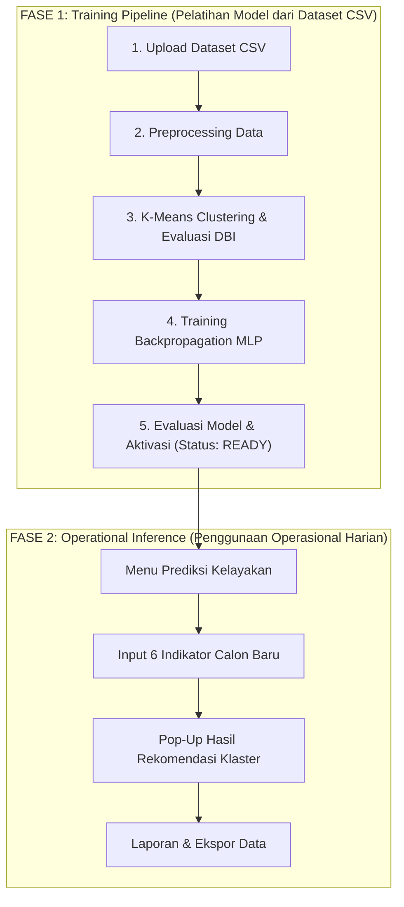

# ALUR DAN PANDUAN OPERASIONAL SISTEM SPK BEASISWA
**Metode:** K-Means Clustering & Artificial Neural Network (ANN) Backpropagation  
**Repositori:** SPK Prediksi Kelayakan Beasiswa

---

## 1. Konsep Dasar & Arsitektur Alur Sistem

Sistem Pendukung Keputusan (SPK) ini memiliki **dua fase utama** yang saling berhubungan:
1. **Fase Penelitian & Pembelajaran Mesin (Batch Training Pipeline):** Menggunakan kumpulan data historis (file CSV) untuk menemukan pola pengelompokan pendaftar dan melatih model jaringan saraf tiruan.
2. **Fase Operasional & Pengambilan Keputusan (Real-Time Inference):** Menggunakan model yang sudah terlatih untuk memprediksi kelayakan pendaftar beasiswa baru secara instan (data perorangan).

---

## 2. Rincian Fase 1: Pelatihan Model (Data Batch CSV)

Fase ini dilakukan di awal atau secara berkala saat ada data pendaftar dalam jumlah besar untuk memperbarui kecerdasan model.

### Langkah 1 — Manajemen Batch & Upload CSV (`/datasets`)
- **Tujuan:** Mengumpulkan data mentah mahasiswa pendaftar beasiswa masa lalu.
- **Data yang Diunggah:** File CSV dengan 6 indikator kanonis:
  1. `ipk` (Indeks Prestasi Kumulatif, 0.00 – 4.00)
  2. `parent_income` (Penghasilan orang tua per bulan dalam Rupiah)
  3. `family_dependents` (Jumlah tanggungan keluarga)
  4. `academic_achievement_score` (Skor prestasi akademik, 0 – 100)
  5. `nonacademic_achievement_score` (Skor prestasi non-akademik, 0 – 100)
  6. `attendance_percentage` (Persentase kehadiran perkuliahan, 0 – 100%)
- **Identitas:** `student_code` dan `student_name` disimpan sebagai metadata identitas dan tidak dijadikan variabel perhitungan algoritma.

### Langkah 2 — Preprocessing Data (`/preprocessing`)
- **Tujuan:** Menyiapkan data mentah menjadi matriks angka bersih berskala standar.
- **Tahapan:**
  - **Imputasi Nilai Kosong (Missing Values):** Menggunakan nilai median data latih agar tahan terhadap outlier sosio-ekonomi.
  - **Normalisasi Fitur:** Menggunakan `MinMaxScaler` untuk mengubah rentang seluruh 6 fitur menjadi seragam $[0, 1]$.
  - **Pencegahan Data Leakage:** Penskalaan dan imputasi dihitung secara terpisah agar data pengujian tidak mencemari proses pembelajaran.

### Langkah 3 — K-Means Clustering & Davies-Bouldin Index (`/clustering`)
- **Tujuan:** Menemukan pola pengelompokan pendaftar secara objektif (*unsupervised learning*) tanpa intervensi subjektif.
- **Proses:**
  - Menjalankan algoritma K-Means untuk beberapa kandidat klaster: $K = 2, 3, 4$.
  - Menghitung nilai **Davies-Bouldin Index (DBI)** untuk setiap $K$.
  - **Aturan Pemilihan:** Nilai DBI terkecil menunjukkan struktur klaster yang paling terpisah dan optimal.
  - Menetapkan klaster terbaik sebagai **Label Acuan (Pseudo-Label)**.

### Langkah 4 — Pelatihan Model Backpropagation MLP (`/training`)
- **Tujuan:** Melatih jaringan saraf tiruan (Multi-Layer Perceptron) agar mampu memetakan 6 indikator mahasiswa ke target klaster acuan secara akurat.
- **Konfigurasi:**
  - Hidden Layers: Contoh `64, 32` neuron.
  - Fungsi Aktivasi: `ReLU` (atau `Sigmoid/Logistic`).
  - Optimizer: `Adam` dengan Early Stopping untuk mencegah overfitting.
  - Pembagian Data: $80\%$ Data Latih, $20\%$ Data Uji.

### Langkah 5 — Evaluasi Model & Aktivasi (`/evaluation`)
- **Tujuan:** Memvalidasi keandalan jaringan saraf sebelum digunakan untuk pengambilan keputusan nyata.
- **Metrik Pengujian:** Akurasi, Macro Precision, Macro Recall, Macro F1-Score, dan Confusion Matrix $K \times K$.
- **Aktivasi (Single Active Model):** Klik tombol **Set Ready** pada model dengan akurasi terbaik. Sistem secara atomik menjadikan model tersebut sebagai model aktif rujukan tunggal untuk inferensi.

---

## 3. Rincian Fase 2: Penggunaan Operasional (Prediksi Real-Time)

Fase ini digunakan oleh operator/panitia seleksi untuk mengevaluasi pelamar baru tanpa perlu mengulang proses pelatihan model.

### Kapan Menggunakan Menu "Prediksi Kelayakan" (`/predictions`)?
1. **Pendaftaran Mahasiswa Baru (1 per 1):**  
   Saat ada mahasiswa baru yang mendaftar atau menyerahkan berkas verifikasi:
   - Operator membuka menu **Prediksi Kelayakan**.
   - Sistem secara otomatis menggunakan model Backpropagation yang berstatus `Ready`.
   - Operator menginput 6 nilai variabel mahasiswa pada formulir.
   - Klik **Jalankan Prediksi**.
2. **Hasil Instan via Pop-Up Modal:**  
   Sistem langsung memunculkan pop-up yang menyajikan:
   - **Klaster Rekomendasi:** Misalnya `Klaster C0`, `Klaster C1`, atau `Klaster C2`.
   - **Tingkat Keyakinan (Confidence Score):** Persentase probabilitas klasifikasi jaringan saraf.
   - **Interpretasi Karakteristik:** Penjelasan kesesuaian profil kandidat terhadap sentroid klaster.
3. **Penyimpanan Riwayat & Ekspor Laporan (`/reports`):**  
   Setiap hasil prediksi otomatis tersimpan di database dan dapat diunduh dalam format CSV sewaktu-waktu untuk rapat pleno panitia beasiswa.

---

## 4. Matriks Perbedaan: Dataset CSV vs Form Prediksi

| Parameter | Dataset CSV (Menu Datasets) | Form Prediksi (Menu Predictions) |
|---|---|---|
| **Tujuan Utama** | Melatih & membentuk kecerdasan model (*training*) | Menggunakan kecerdasan model untuk menilai pelamar baru (*inference*) |
| **Volume Data** | Sekaligus banyak baris (Batch 50 - 1000+ data) | Satu per satu secara real-time saat pelamar mendaftar |
| **Frekuensi Penggunaan**| Sekali di awal periode atau saat kalibrasi ulang model | Digunakan sehari-hari selama masa pendaftaran beasiswa |
| **Ketergantungan** | Menghasilkan artefak model (`.joblib`) | Membutuhkan model yang sudah berstatus `Ready` |
| **Output** | Klaster K-Means, skor DBI, dan bobot sinapsis MLP | Rekomendasi klaster instan via Pop-Up Modal |

---

## 5. Ringkasan Tanya Jawab Operasional

- **T: Apakah saya wajib mengisi form Prediksi jika sudah upload CSV di awal?**  
  *Jawab:* **Tidak wajib** jika tujuan Anda saat ini hanya untuk demonstrasi pelatihan model atau penelitian skripsi/proyek. Data CSV Anda sudah cukup untuk menyelesaikan seluruh siklus eksperimen data mining (Preprocessing, K-Means, Training MLP, hingga Evaluasi Confusion Matrix).
- **T: Kapan saya harus menggunakan form Prediksi?**  
  *Jawab:* Gunakan form Prediksi ketika Anda ingin menguji data uji baru secara interaktif, mensimulasikan skenario mahasiswa tertentu, atau mendemokan cara sistem bekerja saat melayani pelamar baru di lapangan.
