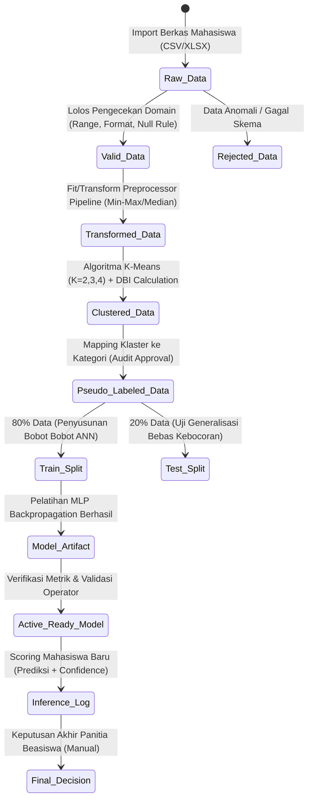
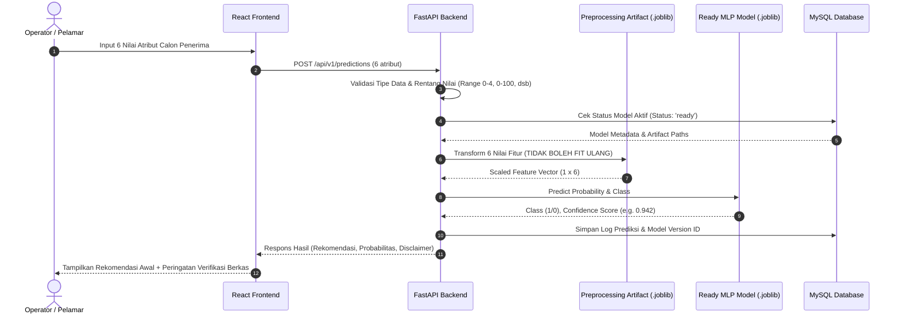

# FASE A: ANALISIS METODOLOGI PENELITIAN & DATA SCIENCE
**Sistem Pendukung Keputusan Seleksi Penerima Beasiswa Menggunakan Kombinasi K-Means Clustering dan Artificial Neural Network (Backpropagation MLP)**

---

## 1. DIAGRAM ALUR PENELITIAN END-TO-END

Penelitian ini mengadopsi kerangka kerja **Knowledge Discovery in Databases (KDD)** yang diintegrasikan ke dalam paradigma *hybrid learning* (Unsupervised Clustering $\rightarrow$ Supervised Classification).

```mermaid
flowchart TD
    subgraph S1["1. Selection & Ingestion"]
        A1["File CSV / Excel Sumber"] --> A2["Pemisahan Identitas (NIM, Nama)<br/>vs 6 Fitur Numerik"]
        A2 --> A3["Pencatatan Batch Mentah<br/>(Raw Record Logging)"]
    end

    subgraph S2["2. Data Cleaning & Sanitization"]
        A3 --> B1{"Validasi Domain Fitur"}
        B1 -- "Tidak Valid (Out of Range)" --> B2["Tandai: Invalid / Perlu Review<br/>(Dicatat Alasan Penolakan)"]
        B1 -- "Lolos Batas Nilai" --> B3["Dataset Bersih (Valid Records)"]
    end

    subgraph S3["3. Transformation & Preprocessing"]
        B3 --> C1["Imputasi Nilai Kosong<br/>(Median / Mean Strategy)"]
        C1 --> C2["Penskalaan Fitur<br/>(Min-Max / Standard Scaler)"]
        C2 --> C3["Penyimpanan Artefak Preprocessing<br/>(Joblib Serialized Pipeline)"]
    end

    subgraph S4["4. Data Mining: K-Means Clustering"]
        C3 --> D1["Eksperimen K-Means<br/>(K = 2, K = 3, K = 4)<br/>Fixed Seed"]
        D1 --> D2["Kalkulasi Davies-Bouldin Index (DBI)"]
        D2 --> D3["Analisis Profil Centroid &<br/>Ukuran Klaster"]
        D3 --> D4["Seleksi Konfigurasi Klaster Optimal<br/>(K* Terbaik)"]
    end

    subgraph S5["5. Interpretasi & Pembentukan Pseudo-Label"]
        D4 --> E1["Analisis Statistik Tiap Klaster<br/>(IPK vs Ekonomi vs Prestasi)"]
        E1 --> E2{"Aturan Pemetaan Bisnis<br/>(Mapping Rule Engine)"}
        E2 --> E3["Persetujuan Operator / Pakar<br/>(Audit Approval Log)"]
        E3 --> E4["Dataset Ber-Pseudo-Label<br/>(layak_prioritas / tidak_prioritas / perlu_review)"]
    end

    subgraph S6["6. Supervised Learning: Backpropagation MLP"]
        E4 --> F1["Stratified Train/Test Split<br/>(80% Train, 20% Test)"]
        F1 --> F2["Fit Backpropagation MLP<br/>(Multilayer Perceptron)"]
        F2 --> F3["Evaluasi Test Bebas Leakage<br/>(Accuracy, Macro F1, Conf. Matrix)"]
        F3 --> F4["Simpan Artefak Model (.joblib)<br/>Status: Ready / Aktif"]
    end

    subgraph S7["7. Inferensi Mahasiswa Baru & Audit"]
        G1["Pengajuan Mahasiswa Baru"] --> G2["Transformasi via Artefak Pipeline (Tanpa Refit)"]
        G2 --> G3["Prediksi Probabilitas & Rekomendasi Awal"]
        G3 --> G4["Ditinjau oleh Panitia Beasiswa<br/>(Human-in-the-loop Final Decision)"]
    end

    S3 -.-> S6
    F4 -.-> G2
```

---

## 2. DIAGRAM ALUR DATA (DATA LINEAGE & TRANSITION)

Perubahan representasi data pada setiap siklus hidup sistem dikontrol secara ketat:

---

## 3. DEFINISI OPERASIONALISASI ENAM FITUR UTAMA

Hanya 6 atribut numerik berikut yang diizinkan masuk ke dalam matriks kalkulasi ($X \in \mathbb{R}^{N \times 6}$):

| No | Nama Atribut | Tipe Data | Format & Rentang Valid | Definisi Operasional & Sumber Data | Kebijakan Nilai Kosong & Outlier | Pengaruh terhadap SPK Beasiswa |
|:--:|:---|:---:|:---:|:---|:---|:---|
| 1 | `ipk` | Float | $0.00 \le x \le 4.00$ | Indeks Prestasi Kumulatif terakhir mahasiswa. Sumber: Pangkalan Data Pendidikan Tinggi (PDDikti) / SIAKAD resmi. | Imputasi: Diizinkan menggunakan nilai **Median** per batch. Outlier: Nilai $<0$ atau $>4.00$ otomatis **Ditolak (Invalid)**. | Indikator kompetensi akademik formal. Berbanding lurus dengan kelayakan. |
| 2 | `parent_income` | Float / Decimal | $x \ge 0$ (Rupiah/Bulan) | Gabungan penghasilan kotor ayah dan ibu per bulan. Sumber: Slip gaji resmi / Surat Keterangan Penghasilan Kelurahan. | Imputasi: **Median**. Outlier: Penghasilan ekstrem (> 50 juta) tetap valid jika disertai dokumen, namun diskalakan via Min-Max/StandardScaler. Nilai negatif **Ditolak**. | Indikator urgensi finansial. Berbanding terbalik dengan kelayakan (kondisi ekonomi lemah lebih diprioritaskan). |
| 3 | `family_dependents` | Integer | $0 \le x \le 20$ (Orang) | Jumlah anggota keluarga dalam 1 Kartu Keluarga (KK) yang belum mandiri secara finansial. Sumber: Kartu Keluarga. | Imputasi: **Median** (dibulatkan). Outlier: Nilai $> 20$ orang wajib ditinjau manual / ditandai `perlu_review`. | Membebani alokasi pendapatan orang tua. Semakin banyak tanggungan, urgensi bantuan semakin tinggi. |
| 4 | `academic_achievement_score` | Float | $0.00 \le x \le 100.00$ | Skor kumulatif prestasi akademik (olimpiade, LKTI, publikasi, lomba ilmiah) berbobot tingkat regional/nasional/internasional. Sumber: Sertifikat resmi. | Imputasi: **Default 0.0** (jika tidak ada sertifikat prestasi yang dilampirkan, bukan median). Outlier: $>100$ dipotong (*clipped*) ke 100 atau invalid. | Pembeda keunggulan kompetitif bidang akademik antar pelamar dengan IPK serupa. |
| 5 | `nonacademic_achievement_score` | Float | $0.00 \le x \le 100.00$ | Skor kumulatif prestasi minat, bakat, olahraga, seni, dan kepemimpinan organisasi. Sumber: Sertifikat/SK Organisasi. | Imputasi: **Default 0.0** (jika tidak melampirkan, diasumsikan tidak memiliki sertifikat). Outlier: $>100$ invalid. | Memperhitungkan kontribusi non-akademik dan soft skill mahasiswa. |
| 6 | `attendance_percentage` | Float | $0.00 \le x \le 100.00$ (%) | Rata-rata persentase kehadiran tatap muka/perkuliahan pada semester terakhir. Sumber: Rekap Absensi SIAKAD. | Imputasi: **Median**. Outlier: $<0$ atau $>100$ otomatis ditolak (*invalid*). | Indikator komitmen dan kedisiplinan belajar mahasiswa. |

### Atribut Pengenal (Non-Fitur ML):
- `student_code` (NIM): Kunci bisnis pelacakan data, pencarian UI, dan indexing audit.
- `student_name` (Nama): Keperluan visualisasi dan penyusunan berkas administrasi panitia.
- *Strict Rule:* Keduanya **dieliminasi dari matriks $X$** sebelum proses normalisasi, clustering, maupun klasifikasi MLP untuk mencegah *spurious correlation* dan pelanggaran privasi algoritmik.

---

## 4. RANCANGAN METODE KDD SECARA MATEMATIS & RIGOR

### A. Preprocessing & Standarisasi Fitur
Perbedaan satuan yang drastis antara `parent_income` ($\sim 10^6$ Rupiah) dengan `ipk` ($\sim 10^0$) akan mendominasi perhitungan jarak Euclidean jika tidak dinormalisasi.
1. **Min-Max Normalization (Default KDD Beasiswa):**
   $$x' = \frac{x - \min(X_{train})}{\max(X_{train}) - \min(X_{train})}$$
   Mentransformasikan seluruh rentang fitur tepat ke domain $[0, 1]$.
2. **StandardScaler (Opsi Robust):**
   $$z = \frac{x - \mu}{\sigma}$$
3. **Pemberian Bobot Imputasi (Anti-Leakage Rule):**
   Parameter statistik ($\min, \max, \mu, \sigma, \text{median}$) dihitung **hanya** pada set data yang sedang dianalisis. Pada evaluasi MLP, estimator dipelajari **hanya dari Training Set** ($80\%$) dan diaplikasikan (*transform only*) ke Testing Set ($20\%$).

---

### B. Segmentasi Mahasiswa: K-Means Clustering & Davies-Bouldin Index (DBI)
1. **Objektif K-Means:**
   Meminimalkan *Within-Cluster Sum of Squares* (WCSS):
   $$J = \sum_{k=1}^{K} \sum_{x_i \in C_k} \| x_i - \mu_k \|^2$$
   di mana $\mu_k$ adalah centroid klaster $k$. Eksperimen dijalankan secara deterministik untuk $K \in \{2, 3, 4\}$ menggunakan algoritma k-means++ dan parameter `random_state=42`.
2. **Evaluasi Kualitas Klaster menggunakan Davies-Bouldin Index (DBI):**
   $$R_{ij} = \frac{s_i + s_j}{d(c_i, c_j)}$$
   $$\text{DBI} = \frac{1}{K} \sum_{i=1}^{K} \max_{j \ne i} R_{ij}$$
   - $s_i$: rata-rata jarak sampel di klaster $i$ ke centroid $c_i$ (*cluster dispersion/scatter*).
   - $d(c_i, c_j)$: jarak Euclidean antarsentroid $c_i$ dan $c_j$ (*cluster separation*).
   - **Kriteria Pemilihan:** Nilai DBI terkecil mengindikasikan klaster yang paling kompak (*compact*) dan terpisah dengan baik (*well-separated*).
   - *Peringatan Metodologis:* Nilai DBI terbaik secara geometris **tidak otomatis** berarti klaster tersebut langsung merefleksikan keadilan beasiswa di dunia nyata. DBI hanya membuktikan struktur pemisahan data matematis.

---

### C. Mekanisme Pembentukan Pseudo-Label (Cluster Interpretation)
Setelah konfigurasi $K$ optimal terpilih, profil centroid diinterpretasikan pada skala data asli:
1. **Aturan Hipotesis Profil Beasiswa:**
   - **Profil Klaster "Prioritas Tinggi":** $\overline{\text{IPK}} \ge 3.25$, $\overline{\text{Parent Income}} \le \text{Kuartil Bawah}$, $\overline{\text{Tanggungan}} \ge 3$, Kehadiran $\ge 85\%$.
   - **Profil Klaster "Kurang Prioritas":** $\overline{\text{IPK}} < 3.00$, $\overline{\text{Parent Income}} \ge \text{Kuartil Atas}$, $\overline{\text{Tanggungan}} \le 2$.
2. **Taksonomi Label SPK:**
   - `layak_prioritas` (Kelas 1)
   - `tidak_prioritas` (Kelas 0)
   - `perlu_review` (Borderline / jika ada tumpang tindih antara IPK tinggi dan pendapatan tinggi).
3. **Penyusunan Target Supervised Learning:**
   Jika model klasifikasi biner diterapkan ($y \in \{0, 1\}$), data berkategori `perlu_review` **tidak boleh diubah diam-diam menjadi 0 atau 1**. Data tersebut harus:
   - Dikeluarkan dari target training biner (disimpan sebagai antrean verifikasi panitia), ATAU
   - Model dilatih menggunakan klasifikasi 3-kelas (*multi-class*).

---

### D. Pelatihan Artificial Neural Network Backpropagation (MLP Classifier)
Model yang diimplementasikan adalah Jaringan Saraf Tiruan Multilayer Perceptron:
1. **Arsitektur Jaringan:**
   - Input Layer: 6 neuron ($x_1, \dots, x_6$).
   - Hidden Layer: Dapat dikonfigurasi (default: 2 lapisan tersembunyi `[64, 32]`).
   - Output Layer: 1 neuron (sigmoid) untuk biner, atau $C$ neuron (softmax) untuk multi-kelas.
   - Fungsi Aktivasi Hidden: Rectified Linear Unit ($\text{ReLU}(z) = \max(0, z)$).
2. **Algoritma Backpropagation & Optimizer:**
   - Menggunakan solver `adam` / `sgd` dengan bobot diperbarui berdasarkan gradien fungsi *Loss* Cross-Entropy:
     $$\mathcal{L} = -\frac{1}{N} \sum_{i=1}^{N} \left[ y_i \log(\hat{y}_i) + (1 - y_i) \log(1 - \hat{y}_i) \right]$$
   - Bobot diperbarui: $W^{(l)} \leftarrow W^{(l)} - \eta \frac{\partial \mathcal{L}}{\partial W^{(l)}} - \alpha W^{(l)}$ ($\alpha$: L2 regularization).
3. **Pencegahan Overfitting:**
   - Menggunakan `early_stopping=True` dengan validation fraction $10\%$.
   - Batas maksimum iterasi (`max_iter`) didefinisikan sebagai plafon komputasi, bukan jumlah epoch statis.

---

### E. Prosedur Evaluasi yang Bebas Data Leakage (*Leakage-Free Validation*)
Untuk memastikan evaluasi akademik yang jujur dan dapat dipertanggungjawabkan:
1. **Split Stratified:** Pembagian $80\%$ Data Train dan $20\%$ Data Test dilakukan dengan mempertahankan proporsi kelas target (`stratify=y`).
2. **Pemisahan Pipeline:** Pipeline normalisasi di-fit HANYA pada $80\%$ train. Data $20\%$ test diperlakukan seperti data baru yang belum pernah dilihat (*unseen test set*).
3. **Metrik Evaluasi:**
   $$\text{Accuracy} = \frac{TP + TN}{TP + TN + FP + FN}$$
   $$\text{Precision}_{macro} = \frac{1}{C}\sum_{c=1}^C \frac{TP_c}{TP_c + FP_c}, \quad \text{Recall}_{macro} = \frac{1}{C}\sum_{c=1}^C \frac{TP_c}{TP_c + FN_c}$$
   $$\text{F1-Score}_{macro} = 2 \times \frac{\text{Precision}_{macro} \times \text{Recall}_{macro}}{\text{Precision}_{macro} + \text{Recall}_{macro}}$$
   Matriks Kebingungan (*Confusion Matrix*) ditampilkan secara eksplisit untuk menunjukkan distribusi True Positive, False Positive, True Negative, False Negative.
4. **Batasan Makna Metrik (Akademik Disclaimer):**
   - Tingginya nilai Akurasi/F1-Score pada tahap ini **hanya membuktikan** bahwa model MLP berhasil meniru pola matematis klaster K-Means dengan baik (*fidelity to pseudo-labels*).
   - Hal tersebut **BUKAN bukti empiris** bahwa model secara mutlak objektif menentukan kelayakan mahasiswa di dunia nyata. Validitas ilmiah sesungguhnya hanya dapat dibuktikan jika kelak model diuji terhadap **label keputusan panitia resmi (*ground truth verified*)**.

---

## 5. ALUR INFERENSI MAHASISWA BARU (OPERASIONAL)

---

## 6. BATASAN METODOLOGIS & RISIKO BIAS PENELITIAN

1. **Cold-Start Pseudo-Labeling:**
   K-Means mempartisi data berdasarkan kedekatan geometris ruang Euclidean. Apabila persebaran data pelamar pada periode tertentu condong ke satu kelompok (misal mayoritas berekonomi mampu), centroid klaster dapat bergeser sehingga interpretasi klaster perlu dikalibrasi ulang.
2. **Outlier Masking:**
   Nilai penghasilan orang tua yang sangat ekstrem (misal konglomerat atau nol rupiah mutlak) dapat membiaskan centroid jika tidak ditangani dengan strategi winsorizing/median yang tepat.
3. **Penyelarasan Keputusan Panitia:**
   Sistem mewajibkan pencatatan *Audit Trail*. Keputusan kelayakan yang dikeluarkan oleh sistem berstatus sebagai **Rekomendasi Awal (*Decision Support*)**; verifikasi dokumen faktual di lapangan tetap menjadi otoritas mutlak panitia beasiswa.
