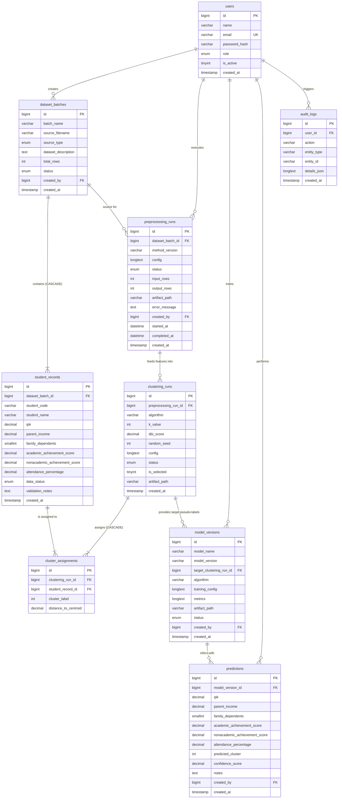

# FASE B: RANCANGAN SISTEM & ARSITEKTUR TEKNIS
**Sistem Pendukung Keputusan Seleksi Penerima Beasiswa Berbasis K-Means Clustering dan Artificial Neural Network Backpropagation**

---

## 1. RINGKASAN BRD & PRD (BUSINESS & PRODUCT REQUIREMENTS)

### A. Business Requirements (Kebutuhan Bisnis)
1. **Objektivitas Seleksi:** Menghilangkan bias manual dalam penentuan kelayakan beasiswa dengan mengombinasikan *unsupervised clustering* (menggali pola alami kelompok mahasiswa) dan *supervised neural network* (inferensi konsisten berkas baru).
2. **Kepatuhan KDD Bebas Kebocoran Data:** Parameter imputasi dan normalisasi wajib dipelajari hanya dari data latih (*training set*) untuk menjaga integritas pengujian akademik.
3. **Auditability & Traceability:** Setiap prediksi kelayakan mahasiswa baru harus dapat ditelusuri (*traceable*) ke versi model, artefak pipeline preprocessing, dan batch dataset pelatihan asal.
4. **Human-in-the-Loop (SPK Bukan Eksekutor Tunggal):** Sistem berfungsi sebagai perekomendasi keputusan (*Decision Support*). Kuota dan verifikasi berkas lapangan tetap berada di bawah wewenang panitia beasiswa.

### B. Product Requirements (Spesifikasi Produk)
1. **6 Atribut Masukan Mutlak:** IPK, Penghasilan Orang Tua, Jumlah Tanggungan, Prestasi Akademik, Prestasi Non-Akademik, dan Persentase Kehadiran.
2. **Pencegahan Data Identitas pada ML:** NIM (`student_code`) dan Nama (`student_name`) wajib diisolasi dari matriks fitur machine learning.
3. **Manajemen Status Model:** Model hanya boleh berstatus `ready` setelah melalui pelatihan sukses, memiliki artefak tersimpan valid, dan metrik evaluasi tercatat.
4. **Penanganan Kasus Keraguan (`perlu_review`):** Menggunakan pendekatan 2-kelas biner (*Layak* vs *Tidak Layak*), sedangkan mahasiswa pada batas abu-abu diisolasi untuk verifikasi manual panitia.

---

## 2. AKTOR DAN USE CASE MATRIX

### A. Aktor Sistem
1. **Administrator (`admin`):** Memiliki hak istimewa penuh: manajemen user, konfigurasi sistem, audit trail, serta semua fitur operasional data mining.
2. **Operator Seleksi (`operator`):** Mengelola batch dataset, mengimpor data, mengeksekusi preprocessing KDD, menjalankan eksperimen K-Means, menyetujui pemetaan pseudo-label, melatih model Backpropagation, dan melakukan inferensi calon penerima.
3. **Viewer / Auditor (`viewer`):** Pengguna eksternal atau pimpinan fakultas dengan hak akses baca (*read-only*) terhadap dashboard KPI, evaluasi model, profil klaster, dan unduhan laporan.

### B. Use Case & Hak Akses (RBAC Matrix)

| Kode UC | Nama Use Case | Admin | Operator | Viewer | Keterangan Endpoint |
|:---:|:---|:---:|:---:|:---:|:---|
| **UC-01** | Autentikasi & Login JWT | ✅ | ✅ | ✅ | `POST /api/v1/auth/login` |
| **UC-02** | Manajemen Akun Pengguna | ✅ | ❌ | ❌ | `GET, POST, PATCH, DELETE /api/v1/users` |
| **UC-03** | Monitoring Audit Trail Log | ✅ | ❌ | ❌ | `GET /api/v1/audit-logs` |
| **UC-04** | Dashboard Analitis & KPI | ✅ | ✅ | ✅ | `GET /api/v1/dashboard/summary` |
| **UC-05** | Buat Batch & Import Data (CSV/Excel) | ✅ | ✅ | ❌ | `POST /api/v1/datasets`, `POST /datasets/{id}/import` |
| **UC-06** | Validasi & Pratinjau Dataset | ✅ | ✅ | ✅ | `GET /datasets/{id}/validation`, `preview` |
| **UC-07** | CRUD Record Mahasiswa | ✅ | ✅ | ❌ | `POST, PATCH, DELETE /api/v1/records` |
| **UC-08** | Eksekusi Preprocessing Pipeline | ✅ | ✅ | ❌ | `POST /api/v1/preprocessing/runs` |
| **UC-09** | Eksperimen K-Means (K=2,3,4) & DBI | ✅ | ✅ | ❌ | `POST /api/v1/clustering/runs` |
| **UC-10** | Interpretasi & Seleksi Klaster Rujukan | ✅ | ✅ | ❌ | `POST /clustering/runs/{id}/select` |
| **UC-11** | Pelatihan Backpropagation MLP | ✅ | ✅ | ❌ | `POST /api/v1/models/train` |
| **UC-12** | Evaluasi Model & Confusion Matrix | ✅ | ✅ | ✅ | `GET /api/v1/models/{id}` |
| **UC-13** | Aktivasi Model (`set-ready`) | ✅ | ✅ | ❌ | `POST /models/{id}/set-ready` |
| **UC-14** | Prediksi Kelayakan Real-time | ✅ | ✅ | ❌ | `POST /api/v1/predictions` |
| **UC-15** | Ekspor Laporan Hasil Prediksi (CSV) | ✅ | ✅ | ✅ | `GET /api/v1/reports/export/predictions` |

---

## 3. ENTITY RELATIONSHIP DIAGRAM (ERD 9 TABEL RELASIONAL)



---

## 4. STRUKTUR DIREKTORI PROYEK

```
beasiswa-spk/
├── backend/
│   ├── app/
│   │   ├── api/
│   │   │   └── v1/
│   │   │       ├── endpoints/
│   │   │       │   ├── auth.py          # Autentikasi JWT & profil
│   │   │       │   ├── dashboard.py     # KPI dan agregat dashboard
│   │   │       │   ├── datasets.py      # Manajemen batch dataset & upload
│   │   │       │   ├── records.py       # CRUD & validasi data mahasiswa
│   │   │       │   ├── preprocessing.py # Preprocessing KDD run
│   │   │       │   ├── clustering.py    # K-Means, DBI, dan seleksi klaster
│   │   │       │   ├── training.py      # Pelatihan model Backpropagation
│   │   │       │   ├── predictions.py   # Inferensi kelayakan real-time
│   │   │       │   ├── reports.py       # Ringkasan eksperimen & ekspor CSV
│   │   │       │   └── users.py         # Manajemen user & audit logs
│   │   │       └── router.py            # Aggregator routing API v1
│   │   ├── core/
│   │   │   ├── config.py                # Konfigurasi env & direktori
│   │   │   └── security.py              # Enkripsi bcrypt & token JWT
│   │   ├── db/
│   │   │   ├── base.py                  # DeclarativeBase SQLAlchemy
│   │   │   └── session.py               # Engine MySQL pool & SessionLocal
│   │   ├── ml/
│   │   │   ├── data_validation.py       # Validasi domain 6 fitur
│   │   │   ├── preprocessing.py         # Imputasi & Min-Max pipeline
│   │   │   ├── clustering.py            # K-Means algoritma & kalkulasi DBI
│   │   │   ├── training.py              # MLP Classifier Scikit-Learn
│   │   │   └── evaluation.py            # Metrik evaluasi & Confusion Matrix
│   │   ├── models/                      # SQLAlchemy ORM Data Models (9 tabel)
│   │   ├── schemas/                     # Pydantic v2 DTO schemas
│   │   ├── repositories/                # Database Query Layer
│   │   ├── services/                    # Business Logic Layer
│   │   └── main.py                      # FastAPI App initialization & CORS
│   └── artifacts/                       # Penyimpanan artefak .joblib pipeline & model
│
├── frontend/
│   ├── src/
│   │   ├── assets/                      # Registrar CSS template & Figtree fonts
│   │   ├── components/                  # UI Components (PageTitle, Loader, ErrorBoundary)
│   │   ├── config/                      # API Endpoints contract dictionary
│   │   ├── features/
│   │   │   ├── auth/                    # Halaman Login
│   │   │   ├── dashboard/               # Halaman Dashboard & Flowchart
│   │   │   ├── datasets/                # Halaman Batch List, Detail, & Import
│   │   │   ├── preprocessing/           # Halaman Preprocessing Runs
│   │   │   ├── clustering/              # Halaman K-Means & DBI Evaluation
│   │   │   ├── training/                # Halaman Pelatihan Model Backprop
│   │   │   ├── evaluation/              # Halaman Metrik Evaluasi & Confusion Matrix
│   │   │   ├── predictions/             # Halaman Form Prediksi Real-Time
│   │   │   ├── reports/                 # Halaman Laporan & Ekspor CSV
│   │   │   └── users/                   # Halaman Manajemen User & Audit Trail
│   │   ├── Layout/                      # MainLayout, Sidebar, Topbar (Registrar Theme)
│   │   ├── services/                    # Axios API Client & Interceptors
│   │   ├── App.jsx                      # Route Mapping & Protected Route Wrappers
│   │   └── main.jsx                     # ReactDOM Root Entry
│   └── package.json
└── docs/                                # Dokumentasi BRD, PRD, Data Dictionary
```

---

## 5. STRATEGI ARTEFAK & AUDIT TRAIL

1. **Format Penyimpanan Artefak (`.joblib`):**
   - **Artefak Preprocessing:** Disimpan dengan nama `preprocessing_{id}_{uuid[:8]}.joblib` berisi objek Scikit-Learn ColumnTransformer / Pipeline lengkap dengan statistik per-kolom yang dipelajari saat fitting.
   - **Artefak Model MLP:** Disimpan dengan nama `model_{id}_{uuid[:8]}.joblib` berisi model `MLPClassifier` terlatih beserta metadata fitur dan pemetaan kelas.
2. **Integritas Penelusuran (Audit Traceability):**
   - Setiap kali inferensi dijalankan di tabel `predictions`, ID model dicatat di `model_version_id`.
   - Melalui `model_version_id`, panitia dapat melacak:
     $$\text{Prediction} \rightarrow \text{Model Version} \rightarrow \text{Clustering Run (DBI)} \rightarrow \text{Preprocessing Run} \rightarrow \text{Batch Dataset Induk}$$
   - Sistem menjamin replikasi 100% dan transparansi komprehensif bagi auditor akademik.
